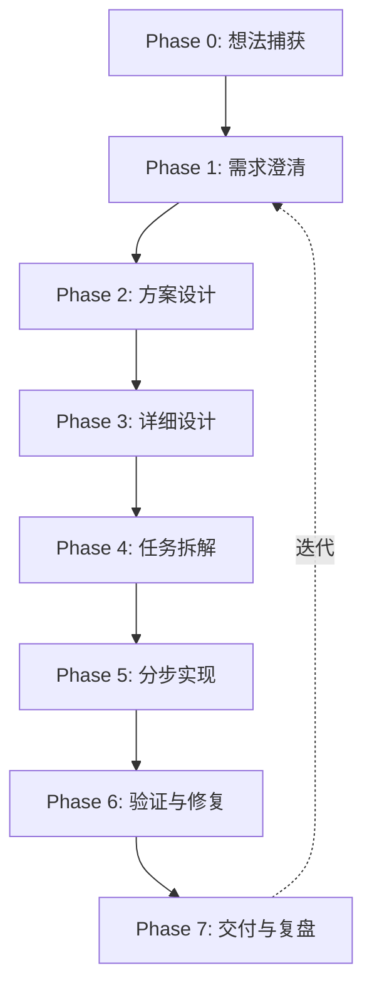

# AI 编程工作流总览

## 为什么需要工作流

| 只有提示词 | 完整工作流 |
|-----------|-----------|
| 每次从零开始 | 每步有标准输入/输出 |
| AI 容易跳步（没设计就写代码） | 门禁：上一步没过，不进下一步 |
| 质量靠临场发挥 | 质量靠模板 + checklist |
| 难迭代改进 | 哪步出问题就改哪步的模板 |

工作流 = **提示词 + 阶段划分 + 产物模板 + 人工审核点 + 工具配置（Cursor Rules / Skills）**

---

## 七阶段流程

---

## Phase 0：想法捕获

| 项 | 内容 |
|----|------|
| **输入** | 脑中的粗糙想法 |
| **输出** | `idea.md`（3～10 句话 + 关键词） |
| **AI 角色** | 整理口语为结构化草稿，不扩写、不设计 |
| **人工** | 确认「这是我想做的那件事」 |
| **模板** | [templates/idea.md](templates/idea.md) |

---

## Phase 1：需求澄清

| 项 | 内容 |
|----|------|
| **输入** | `idea.md` |
| **输出** | `spec.md`（MVP 范围、用户场景、完成标准、明确不做） |
| **AI 角色** | 提问、列假设、标风险、建议砍范围 |
| **门禁** | 所有「假设」必须被人确认或否定 |
| **禁止** | 不写技术方案、不写代码 |
| **模板** | [templates/spec.md](templates/spec.md) |
| **提示词** | [templates/prompts.md#phase-1-需求澄清](templates/prompts.md) |

---

## Phase 2：方案设计

| 项 | 内容 |
|----|------|
| **输入** | `spec.md` + 技术偏好/约束 |
| **输出** | `decision.md`（选定方案 + 理由 + 放弃的方案） |
| **AI 角色** | 2～3 种架构/技术路线对比 |
| **门禁** | 必须明确说「按方案 X 继续」 |
| **禁止** | 不写完整接口/表结构 |
| **模板** | [templates/decision.md](templates/decision.md) |
| **提示词** | [templates/prompts.md#phase-2-方案对比](templates/prompts.md) |

---

## Phase 3：详细设计

| 项 | 内容 |
|----|------|
| **输入** | `spec.md` + `decision.md` |
| **输出** | `design.md`（架构、数据、API、页面、测试策略、里程碑） |
| **AI 角色** | 按固定章节模板生成完整设计文档 |
| **门禁** | 逐章评审，用修订提示词只改有问题章节 |
| **禁止** | 不写实现代码 |
| **模板** | [templates/design.md](templates/design.md) |
| **提示词** | [templates/prompts.md#phase-3-详细设计](templates/prompts.md) |

---

## Phase 4：任务拆解

| 项 | 内容 |
|----|------|
| **输入** | `design.md` |
| **输出** | `tasks/*.md`（可独立开发的小任务，带验收标准） |
| **每个任务包含** | 目标、涉及文件/模块、依赖、验收 checklist、禁止改动范围 |
| **门禁** | 任务粒度要小（通常 1 次 AI 会话能完成一个） |
| **模板** | [templates/task.md](templates/task.md) |

---

## Phase 5：分步实现

| 项 | 内容 |
|----|------|
| **输入** | 单个任务 + `design.md` 相关章节 + 项目 Rules |
| **输出** | 可运行代码 + 必要测试 |
| **AI 角色** | 实现员，不是架构师 |
| **门禁** | 只改任务指定范围；改完跑测试/lint；不编造 API/依赖；不省略关键代码 |
| **禁止** | 不重做架构、不扩 MVP 范围 |
| **提示词** | [templates/prompts.md#phase-5-分步实现](templates/prompts.md) |

---

## Phase 6：验证与修复

| 项 | 内容 |
|----|------|
| **输入** | 任务验收 checklist + 测试命令 |
| **输出** | 通过验收，或 bug 修复记录 |
| **流程** | 跑测试 → 失败则喂给 AI 错误日志 → 修复 → 再跑 |
| **门禁** | checklist 全勾才算任务完成 |

---

## Phase 7：交付与复盘

| 项 | 内容 |
|----|------|
| **输入** | 本迭代所有产物 |
| **输出** | changelog、更新后的 Rules、工作流改进点 |
| **AI 角色** | 总结「哪些提示词有效、哪些步骤常出问题」 |
| **价值** | 工作流会越用越准 |

---

## 阶段门禁一览

| 阶段 | 常见失败 | 门禁 |
|------|----------|------|
| 需求 | AI 脑补需求 | 假设必须人工确认 |
| 方案 | 直接写代码 | 未选方案不得进入 Phase 3 |
| 设计 | 文档空洞 | 每个 P0 功能必须有验收标准 |
| 实现 | 改太多、半成品 | 任务级文件范围 + Rules |
| 验证 | 「应该能跑」 | 必须跑测试并贴结果 |

可在提示词中写死：

> **当前阶段：Phase X。只允许做本阶段产物，禁止进入下一阶段。**

---

## 与传统软件工程的对应

| 传统工程 | AI 工作流 |
|---------|-----------|
| 立项 | Phase 0 想法捕获 |
| 需求分析 | Phase 1 spec |
| 技术评审 | Phase 2 decision |
| 概要/详细设计 | Phase 3 design |
| 迭代计划 | Phase 4 tasks |
| 开发 | Phase 5 分步实现 |
| QA | Phase 6 验证 |
| 回顾 | Phase 7 复盘 |

---

## 在 Cursor 中的落地

| 工作流阶段 | Cursor 落地方式 |
|-----------|----------------|
| Phase 0～3 | Chat / Agent + 阶段提示词模板 |
| Phase 4 | 生成 `tasks/` markdown，人工排期 |
| Phase 5 | Agent + `.cursor/rules/` |
| Phase 5 | Skills（先 plan 再 code、改完必须 verify） |
| Phase 6 | 终端跑测试，失败日志回灌 AI |

可为每个 Phase 创建 Skill 文件，内容包含该阶段的提示词 + 规则 + 输出格式。

---

## 两种编排方式

### 方式 A：人工驱动（推荐起步）

按阶段开新对话或新任务，每步粘贴上一阶段产物。

- 优点：简单、可控
- 缺点：要靠人记得别跳步

### 方式 B：半自动（进阶）

用 Skill / Automation 在阶段结束时检查产物是否存在、格式是否齐全，再进入下一步。

- 优点：更少跳步
- 缺点：要先搭好 Skill 和目录约定

**建议：先从 A 跑通 1 个小项目，再固化成 B。**

---

## 入门步骤

1. 定工作流骨架（七个 Phase）
2. 每个 Phase 写 1 个主提示词 + 1 个输出模板
3. 用一个小想法完整走一遍（哪怕做个 Todo + API）
4. 复盘哪步最卡，再加强那步的 Rules 或门禁
5. 打包成 Cursor Skills，形成「AI 编程工作流包」
