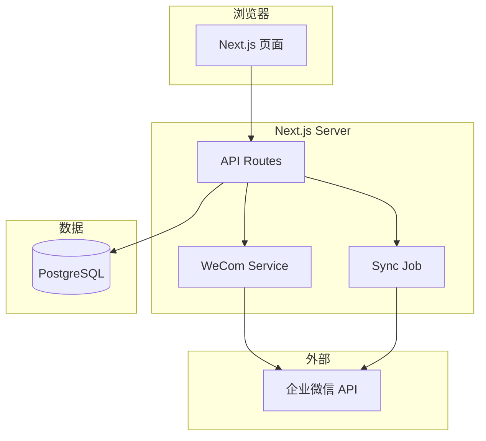
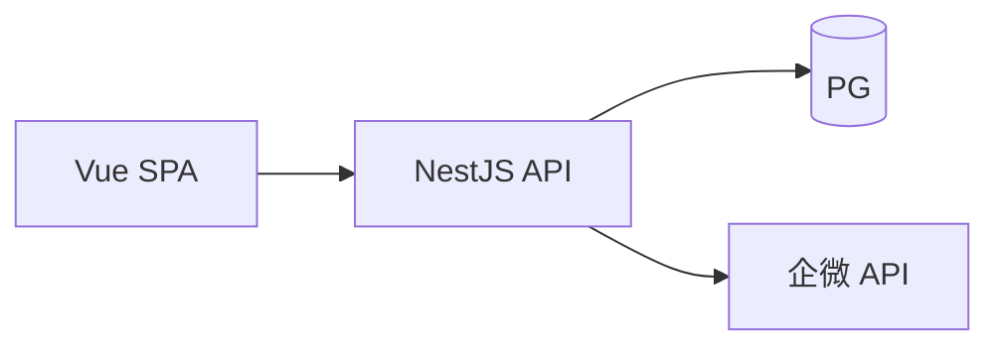

# 方案决策记录 — 企业微信管理工具

> Phase 2 产物：技术方案选型

## 背景

基于 [spec.md](spec.md)：单企业 IT 管理后台，需对接企微 API，实现通讯录同步、组织展示、文本消息发送。约 500 人规模，内网部署，3～4 周 MVP。

## 约束条件

- 团队规模：个人开发
- 技术偏好：TypeScript
- 时间目标：3～4 周 MVP
- 部署环境：公司内网，Docker 可选

---

## 方案 A：Next.js 全栈 Monolith（推荐）

### 概述

使用 Next.js 14 App Router 同时承载 Web UI 和 API，Prisma 访问数据库，服务端封装企微 API 客户端。

### 技术栈

| 层 | 技术 |
|----|------|
| 框架 | Next.js 14 (App Router) |
| 语言 | TypeScript |
| UI | Tailwind CSS + shadcn/ui |
| ORM | Prisma |
| 数据库 | SQLite（开发）/ PostgreSQL（生产） |
| 认证 | NextAuth.js Credentials 或自研 JWT Session |
| 部署 | Docker + docker-compose |

### 架构简图

### 优点

- 单仓库、单人开发效率最高
- 前后端共享类型定义
- 社区生态成熟，shadcn/ui 适合管理台
- `docker compose up` 易演示

### 缺点

- 同步任务与 Web 进程耦合（MVP 可接受）
- Next.js 学习曲线（App Router）

### 适合场景

个人 / 小团队快速 MVP，内网单机部署

### 主要风险

- 长时间同步阻塞请求 → 缓解：同步放 async job + 状态轮询
- Secret 泄露 → 缓解：加密存储 + 环境变量

### MVP 实现难度

**中**

---

## 方案 B：Vue3 + NestJS 前后端分离

### 概述

前端 Vite + Vue3 + Element Plus，后端 NestJS 提供 REST API，独立部署。

### 技术栈

Vue3、NestJS、TypeORM、PostgreSQL

### 架构简图

### 优点

- 前后端职责清晰
- NestJS 模块化适合大型后端

### 缺点

- 两个项目，联调成本高
- 类型共享需额外工具（openapi-typescript）
- 个人开发 MVP 周期更长

### 适合场景

已有 NestJS 团队、前后端分工明确

### 主要风险

CORS、部署两套服务增加运维

### MVP 实现难度

**中高**

---

## 方案 C：FastAPI + React

### 概述

Python FastAPI 后端 + React 前端，快速写 API 胶水层。

### 优点

- FastAPI 写 HTTP 客户端简洁
- Python 企微 SDK 社区有一些

### 缺点

- 用户不熟 Python，维护成本高
- 前后端分离同样双项目

### 适合场景

团队 Python 为主

### 主要风险

技术栈分裂

### MVP 实现难度

**中**

---

## 决策

| 项 | 内容 |
|----|------|
| **选定方案** | 方案 A：Next.js 全栈 + Prisma |
| **理由** | 单人 TypeScript 全栈最高效；单仓库易部署；shadcn/ui 适合后台；满足 3～4 周 MVP |
| **放弃的方案** | 方案 B（双项目过重）、方案 C（Python 非用户强项） |
| **在什么情况下应选其他方案** | 若团队已有 NestJS 中台或需拆独立 API 服务给第三方，改选方案 B |

## 状态

- [x] 方案已拍板
- [x] 可进入 Phase 3 详细设计
