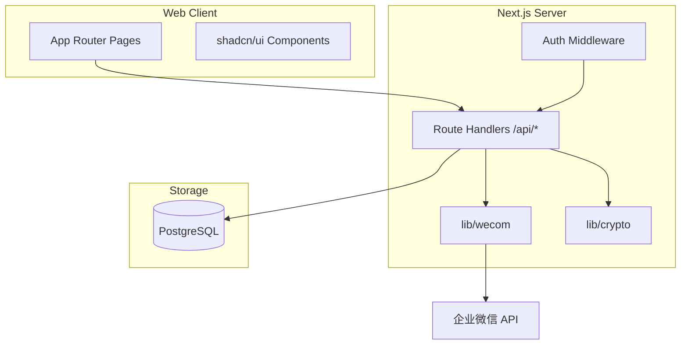
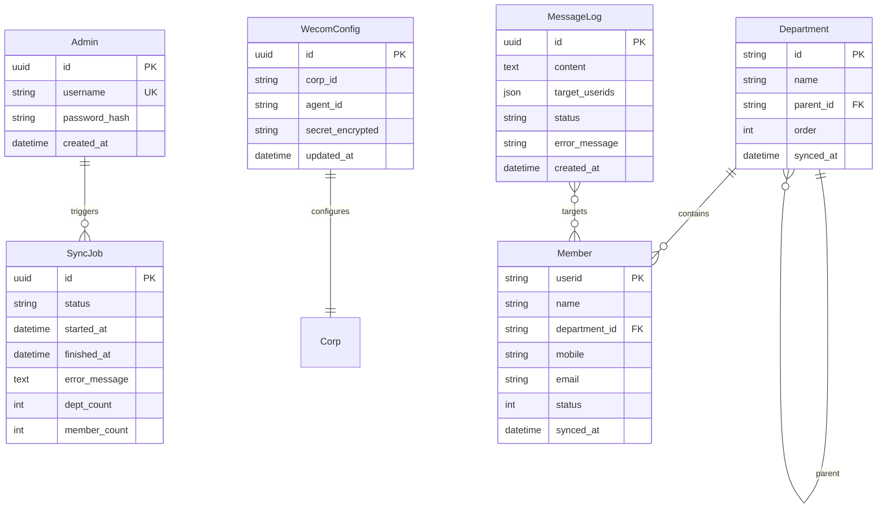
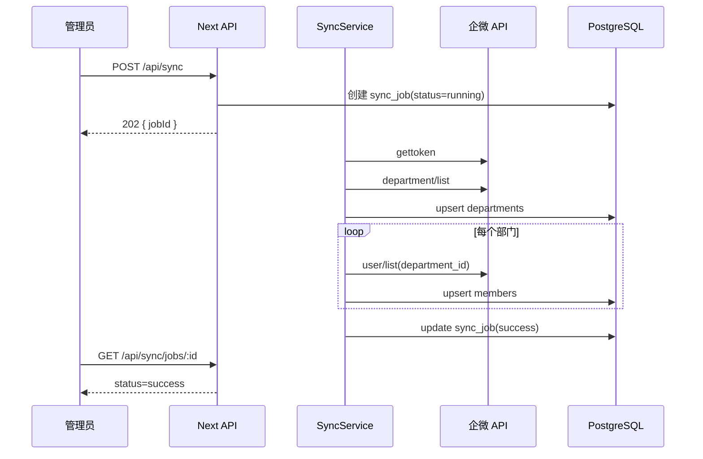
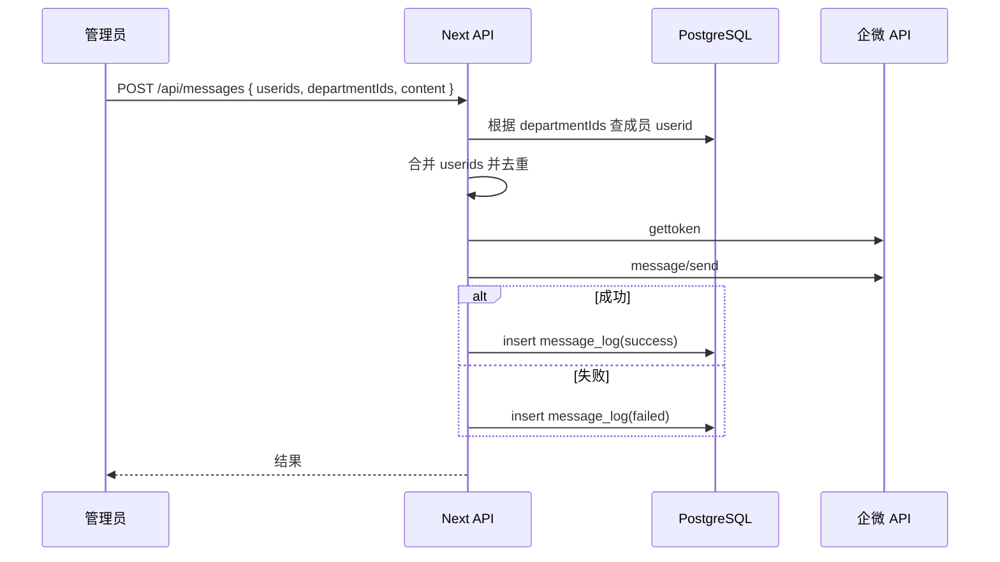

# 详细设计文档 — 企业微信管理工具

> Phase 3 产物（已评审修订）

## 元信息

| 项 | 内容 |
|----|------|
| 项目名称 | 企业微信管理工具（qywx-admin） |
| 版本 | v0.1 |
| 基于 Spec | [spec.md](spec.md) |
| 基于决策 | [decision.md](decision.md) |

---

# 1. 项目概述

## 1.1 背景

公司已使用企业微信，但日常管理操作分散在企微管理后台，IT/行政人员希望有简洁的自有 Web 工具聚合常用能力。

## 1.2 目标

- 配置企微 API 凭证并安全存储
- 将通讯录同步到本地，提供部门树与成员检索
- 支持向成员/部门发送文本应用消息，并留存记录

## 1.3 非目标（明确不做）

见 spec.md「明确不做」：客户联系、审批打卡、图文消息、多租户、企微 OAuth、移动端、RBAC。

## 1.4 用户画像

| 角色 | 描述 | 核心诉求 |
|------|------|----------|
| IT 管理员 | 维护系统与企微对接 | 配置凭证、同步通讯录、排查同步/发送失败 |
| 行政人员 | 日常通知发放 | 查人、发消息、看发送记录 |

---

# 2. 功能需求

## 2.1 用户故事

- As an **IT 管理员**, I want **配置 corpId/agentId/secret**, so that **系统能调用企微 API**。
- As an **IT 管理员**, I want **手动触发通讯录同步**, so that **本地数据与企微一致**。
- As an **行政人员**, I want **浏览部门树并搜索成员**, so that **快速定位通知对象**。
- As an **IT 管理员**, I want **向成员或部门发送文本消息**, so that **统一入口群发通知**。
- As an **IT 管理员**, I want **查看同步与发送历史**, so that **审计与排错**。

## 2.2 功能列表

| 功能 | 优先级 | 说明 | 验收标准 |
|------|--------|------|----------|
| F1 管理员登录 | P0 | 本地账号密码 | 未登录跳转登录页；错误密码提示 |
| F2 凭证配置 | P0 | corpId/agentId/secret | 保存后可调通 gettoken；secret 掩码显示 |
| F3 通讯录同步 | P0 | 手动全量同步 | 同步后部门/成员数量与企微一致 |
| F4 部门树 | P0 | 树形展示 | 展开折叠正确；层级正确 |
| F5 成员列表 | P0 | 筛选/搜索/分页 | 按部门筛选；姓名搜索；默认 20 条/页 |
| F6 发送消息 | P0 | 文本，选人/部门 | 企微客户端收到；部门多选成员去重 |
| F7 发送记录 | P0 | 历史列表 | 含时间、内容摘要、目标、状态 |
| F8 同步日志 | P0 | sync_jobs 列表 | 含时间、状态、耗时、错误 |
| 定时自动同步 | P1 | — | v1 不做 |
| 图文消息 | P1 | — | v1 不做 |

## 2.3 核心用户流程

1. **首次使用**：登录 → 设置 → 填写企微凭证 → 保存 → 通讯录页 → 点击「立即同步」→ 等待完成 → 查看部门树
2. **日常发消息**：登录 → 消息 → 选择成员/部门 → 输入文本 → 发送 → 在发送记录确认成功
3. **排错**：设置 → 同步日志 / 消息 → 发送记录 → 查看失败原因

---

# 3. 非功能需求

| 类别 | 要求 | 理由 |
|------|------|------|
| 性能 | 成员列表首屏 < 1s（500 人，本地 DB） | 读本地缓存，不实时调企微 |
| 性能 | 全量同步 500 人 < 60s | 体验可接受 |
| 安全 | secret AES 加密存储；API 不返回明文 | 凭证泄露风险 |
| 安全 | 管理 API 需 Session；生产 HTTPS | 内网亦防嗅探 |
| 可用性 | 同步中按钮禁用 + 进度/状态展示 | 防重复触发 |
| 可维护性 | 企微 API 封装在 `lib/wecom/` | 便于替换与测试 |

---

# 4. 系统架构

## 4.1 总体架构图



## 4.2 模块划分与职责

| 模块 | 路径 | 职责 |
|------|------|------|
| 认证 | `lib/auth/` | Session、密码校验、中间件 |
| 企微客户端 | `lib/wecom/` | token、通讯录、发消息 API 封装 |
| 同步服务 | `lib/sync/` | 全量同步逻辑、写入 DB |
| 加密 | `lib/crypto/` | secret 加解密 |
| API | `app/api/` | REST 路由 |
| 页面 | `app/(dashboard)/` | 管理界面 |
| 数据访问 | `lib/db/` + Prisma | 数据库操作 |

## 4.3 技术选型及理由

| 技术 | 用途 | 理由 | 不选的替代方案 |
|------|------|------|----------------|
| Next.js 14 | 全栈框架 | 单人高效、API+UI 一体 | NestJS+Vue（过重） |
| Prisma | ORM | 类型安全、迁移方便 | TypeORM、Drizzle |
| PostgreSQL | 生产 DB | 关系数据、内网成熟 | MySQL（亦可，非必须换） |
| SQLite | 开发 DB | 零配置本地开发 | — |
| shadcn/ui | UI 组件 | 可定制、后台常用 | Ant Design（更重） |
| bcrypt | 密码哈希 | 成熟标准 | 明文（禁止） |

---

# 5. 数据设计

## 5.1 核心实体与关系



## 5.2 数据表结构

### 表：admins

| 字段 | 类型 | 约束 | 说明 |
|------|------|------|------|
| id | UUID | PK | |
| username | VARCHAR(64) | UNIQUE, NOT NULL | 登录名 |
| password_hash | VARCHAR(255) | NOT NULL | bcrypt |
| created_at | TIMESTAMP | NOT NULL | |

### 表：wecom_config

| 字段 | 类型 | 约束 | 说明 |
|------|------|------|------|
| id | UUID | PK | 单行配置 |
| corp_id | VARCHAR(64) | NOT NULL | 企业 ID |
| agent_id | VARCHAR(64) | NOT NULL | 应用 AgentId |
| secret_encrypted | TEXT | NOT NULL | AES 加密后的 secret |
| updated_at | TIMESTAMP | NOT NULL | |

### 表：departments

| 字段 | 类型 | 约束 | 说明 |
|------|------|------|------|
| id | VARCHAR(64) | PK | 企微部门 id |
| name | VARCHAR(128) | NOT NULL | |
| parent_id | VARCHAR(64) | FK nullable | 根部门 null |
| order | INT | DEFAULT 0 | 排序 |
| synced_at | TIMESTAMP | NOT NULL | |

### 表：members

| 字段 | 类型 | 约束 | 说明 |
|------|------|------|------|
| userid | VARCHAR(64) | PK | 企微成员 userid |
| name | VARCHAR(128) | NOT NULL | |
| department_ids | JSON | NOT NULL | 所属部门 id 数组 |
| mobile | VARCHAR(32) | nullable | 掩码展示 |
| email | VARCHAR(128) | nullable | |
| status | INT | NOT NULL | 1=已激活 |
| synced_at | TIMESTAMP | NOT NULL | |

### 表：sync_jobs

| 字段 | 类型 | 约束 | 说明 |
|------|------|------|------|
| id | UUID | PK | |
| status | VARCHAR(16) | NOT NULL | pending/running/success/failed |
| started_at | TIMESTAMP | NOT NULL | |
| finished_at | TIMESTAMP | nullable | |
| error_message | TEXT | nullable | |
| dept_count | INT | DEFAULT 0 | |
| member_count | INT | DEFAULT 0 | |

### 表：message_logs

| 字段 | 类型 | 约束 | 说明 |
|------|------|------|------|
| id | UUID | PK | |
| content | TEXT | NOT NULL | 消息正文 |
| target_userids | JSON | NOT NULL | 实际发送 userid 列表 |
| target_desc | VARCHAR(255) | NOT NULL | 展示用「张三等3人」 |
| status | VARCHAR(16) | NOT NULL | success/failed |
| error_message | TEXT | nullable | |
| created_at | TIMESTAMP | NOT NULL | |

## 5.3 关键索引

- `members(name)` — 姓名搜索
- `departments(parent_id)` — 树构建
- `sync_jobs(started_at DESC)` — 日志列表
- `message_logs(created_at DESC)` — 发送记录

---

# 6. 接口设计

## 6.1 API 列表

| 方法 | 路径 | 说明 | 鉴权 |
|------|------|------|------|
| POST | /api/auth/login | 登录 | 否 |
| POST | /api/auth/logout | 登出 | 是 |
| GET | /api/auth/me | 当前用户 | 是 |
| GET | /api/config | 获取企微配置（secret 掩码） | 是 |
| PUT | /api/config | 更新企微配置 | 是 |
| POST | /api/sync | 触发全量同步 | 是 |
| GET | /api/sync/jobs | 同步任务列表 | 是 |
| GET | /api/sync/jobs/:id | 同步任务状态 | 是 |
| GET | /api/departments | 部门树 | 是 |
| GET | /api/members | 成员列表（分页/搜索） | 是 |
| POST | /api/messages | 发送文本消息 | 是 |
| GET | /api/messages | 发送记录列表 | 是 |

## 6.2 请求/响应示例

### PUT /api/config

**请求：**
```json
{
  "corpId": "ww1234567890",
  "agentId": "1000002",
  "secret": "xxx-secret-xxx"
}
```

**响应：**
```json
{
  "corpId": "ww1234567890",
  "agentId": "1000002",
  "secret": "******",
  "updatedAt": "2026-07-06T10:00:00Z"
}
```

### GET /api/members?departmentId=2&keyword=张&page=1&pageSize=20

**响应：**
```json
{
  "items": [
    {
      "userid": "zhangsan",
      "name": "张三",
      "departmentIds": ["2", "5"],
      "mobile": "138****8000",
      "status": 1
    }
  ],
  "total": 1,
  "page": 1,
  "pageSize": 20
}
```

### POST /api/messages

**请求：**
```json
{
  "userids": ["zhangsan", "lisi"],
  "departmentIds": ["5"],
  "content": "请各位下午2点开会"
}
```

**响应：**
```json
{
  "id": "uuid",
  "status": "success",
  "targetCount": 15,
  "targetDesc": "张三、李四等15人"
}
```

**错误码：**

| HTTP | code | 说明 |
|------|------|------|
| 401 | UNAUTHORIZED | 未登录 |
| 400 | INVALID_PARAMS | 参数错误 |
| 400 | CONFIG_MISSING | 未配置企微凭证 |
| 409 | SYNC_IN_PROGRESS | 同步进行中 |
| 502 | WECOM_API_ERROR | 企微 API 失败 |

## 6.3 外部依赖接口（企业微信）

| 企微 API | 用途 |
|----------|------|
| GET /cgi-bin/gettoken | 获取 access_token |
| GET /cgi-bin/department/list | 部门列表 |
| GET /cgi-bin/user/list | 部门成员详情 |
| POST /cgi-bin/message/send | 发送应用消息 |

文档：https://developer.work.weixin.qq.com/document/

---

# 7. 前端设计

## 7.1 页面列表

| 页面 | 路由 | 说明 |
|------|------|------|
| 登录 | `/login` | 账号密码 |
| 仪表盘 | `/` | 概览：最近同步、发送统计 |
| 通讯录 | `/contacts` | 左树右表 |
| 发消息 | `/messages/new` | 选人/部门 + 文本框 |
| 发送记录 | `/messages` | 历史列表 |
| 设置 | `/settings` | 企微凭证配置 |
| 同步日志 | `/settings/sync-logs` | sync_jobs 列表 |

## 7.2 状态管理

- 服务端组件优先拉取初始数据
- 客户端交互（树选中、分页、同步轮询）用 React `useState` + `fetch`
- 登录态：httpOnly Cookie Session，不存 token 到 localStorage

## 7.3 关键交互

- **通讯录页**：左侧部门树点击 → 右侧成员列表按 `departmentId` 筛选
- **同步**：点击「立即同步」→ POST /api/sync → 每 2s 轮询 job 状态 → 完成后刷新树
- **发消息**：成员多选 chips + 部门多选；提交前展示预估人数；部门成员自动去重

---

# 8. 关键流程

## 8.1 通讯录全量同步



## 8.2 按部门发消息（成员去重）



---

# 9. 安全与权限

- **认证**：管理员本地账号 + bcrypt + httpOnly Session Cookie
- **授权**：v1 所有登录管理员同等权限，无 RBAC
- **敏感数据**：secret AES-256-GCM 加密，密钥来自环境变量 `ENCRYPTION_KEY`
- **展示**：手机号掩码；secret 仅掩码
- **企微 token**：内存缓存，不落库，过期前 5 分钟刷新

---

# 10. 部署与运维

| 环境 | 说明 |
|------|------|
| 开发 | `pnpm dev`，SQLite，`.env.local` |
| 生产 | Docker Compose：next + postgres，内网 HTTPS 反向代理 |

**环境变量：**

| 变量 | 说明 |
|------|------|
| DATABASE_URL | 数据库连接串 |
| SESSION_SECRET | Session 签名密钥 |
| ENCRYPTION_KEY | 32 字节 hex，加密 secret |
| INITIAL_ADMIN_PASSWORD | 首次启动种子管理员（可选） |

**日志**：结构化 JSON 日志到 stdout；记录企微 API 错误码，不记录 secret。

---

# 11. 测试策略

| 类型 | 范围 |
|------|------|
| 单元测试 | `lib/wecom/` token 缓存、`lib/sync/` 去重逻辑、`lib/crypto/` |
| 集成测试 | API routes + 测试 DB（登录、config CRUD） |
| E2E | 选手动：登录 → 同步 → 发消息（依赖真实企微测试 corp） |

## 验收标准（Checklist）

- [ ] 所有 P0 API 有集成测试或手工用例
- [ ] 未登录访问 /api/* 返回 401
- [ ] secret 不出现在 GET 响应明文
- [ ] 部门多选发消息 userid 去重正确

---

# 12. 里程碑

| 阶段 | 交付物 | 时间 |
|------|--------|------|
| M1 基础架 | 项目骨架、DB、登录 | 第 1 周 |
| M2 通讯录 | 配置、同步、部门树、成员列表 | 第 2～3 周 |
| M3 消息 | 发消息、记录、日志、部署文档 | 第 4 周 |

---

# 13. 待决问题与风险

| 问题/风险 | 影响 | 缓解措施 | 状态 |
|-----------|------|----------|------|
| 企微 API 限频 | 同步慢或失败 | 顺序拉取；失败可重试；日志提示 | 已规划 |
| 大部门成员过多 | user/list 分页 | 企微 API fetch_child + 分页参数 | 待联调确认 |
| secret 轮换 | 旧 secret 失效 | 设置页支持更新并立即验证 | 已规划 |
| 同步与 Web 同进程 | 长任务占资源 | MVP 接受；P1 可拆 worker | 已知 |

---

## 状态

- [x] 各章已评审
- [x] P0 功能均有验收标准
- [x] 可进入 Phase 4 任务拆解

## 设计评审确认问题（已关闭）

1. ~~是否定时同步~~ → v1 仅手动
2. ~~secret 返回策略~~ → 掩码
3. ~~部门发消息去重~~ → 已写入 §8.2

## 若资源减半应砍掉

- 仪表盘统计（保留简单跳转）
- 同步日志独立页（合并到设置页 Tab）
- 成员手机号展示
