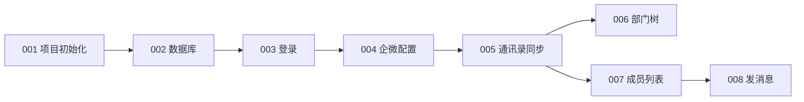

# 开发任务总览

> Phase 4 产物索引。按依赖顺序执行。

## 依赖关系



## 任务列表

| ID | 任务 | 预估 | 依赖 | 文件 |
|----|------|------|------|------|
| 001 | 项目初始化 | 0.5d | — | [001-project-init.md](001-project-init.md) |
| 002 | 数据库 Schema | 0.5d | 001 | [002-database-schema.md](002-database-schema.md) |
| 003 | 管理员登录 | 1d | 002 | [003-admin-auth.md](003-admin-auth.md) |
| 004 | 企微凭证配置 | 1d | 003 | [004-wecom-config.md](004-wecom-config.md) |
| 005 | 通讯录同步 | 2d | 004 | [005-sync-contacts.md](005-sync-contacts.md) |
| 006 | 部门树展示 | 1d | 005 | [006-department-tree.md](006-department-tree.md) |
| 007 | 成员列表 | 1d | 005 | [007-member-list.md](007-member-list.md) |
| 008 | 发送应用消息 | 1.5d | 007 | [008-send-message.md](008-send-message.md) |

**合计预估：** 约 8.5 人日（与 spec 3～4 周 MVP 一致）

## 给 Cursor Agent 的使用方式

每个任务开新对话，粘贴：

```markdown
请实现 Task-XXX。你是实现员，不是架构师。

【任务】
（粘贴 tasks/xxx.md 全文）

【设计文档】
（粘贴 design.md 相关章节）

【约束】
遵守 .cursor/rules/ 下所有规则。
```
